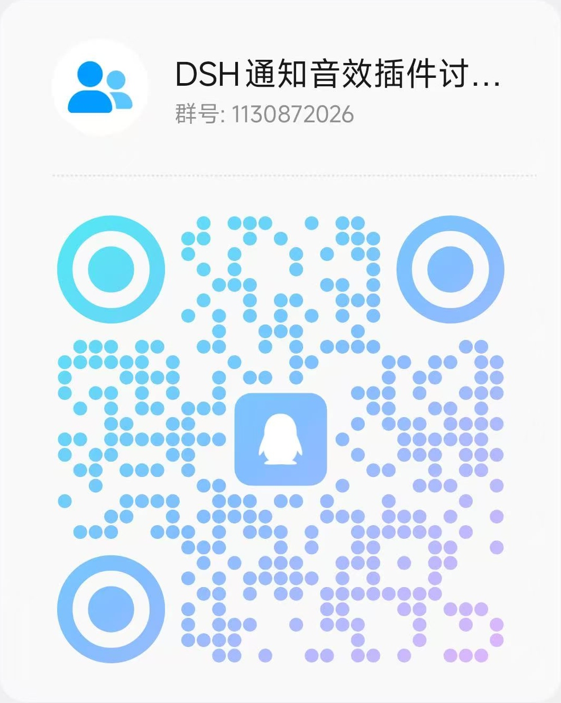

# dsh-task-ping

DSH 任务提醒插件：**对话一结束就提醒你**，三种手段合在一个插件里。

| 手段 | 说明 | 平台 |
|---|---|---|
| 桌面弹窗 | 系统通知，点一下跳回对应会话 | Windows / macOS / Linux（走浏览器通知） |
| 提示音 + 自动压低音乐 | 声音在 **通信端点** 播放，Windows 按「通信活动」把其他媒体自动压到 50%，播完自动恢复；不改任何人音量 | Windows |
| 邮件推送 | 同一份内容再发一封邮件到手机，人不在电脑前也能收到 | 全平台 |

触发时机：**每轮对话结束**、**需要你审批**、**需要你回答**、**需要你确认计划**。二级会话（子代理）不打扰。

## 安装

DSH 插件市场里搜 `dsh-task-ping` 一键装；或命令行：

```sh
dsh plugin --profile desktop add dsh-task-ping
```

装完**完全退出并重开 DSH**（客户端模块不热更），再到 **设置 → 通用** 里确认「任务完成提醒」是开的。

## 设置页：一个「通知」模块

设置 → 通用 → 「任务完成通知」是**总开关**：

- **打开**：下方的提示音、音量、邮件推送都可以单独调。音量滑块**松开即试听**：按当前音量立刻响；连续点击会**打断上一声**、用新音量重播，不会叠加也不会忽大忽小。
- **关闭**：弹窗、提示音、邮件**全部停用**，下面所有选项**置灰并锁定**（真实 `disabled`，不是只变颜色）——想改任何子项，得先把总开关打开。

## 桌面提醒

- 提示音走 Windows 的 *通信* 播放端点，系统会按「声音 → 通信」里的档位自动压低其他媒体（默认 50%）。插件**不修改**任何应用的音量。
- 副作用：为了让声音落在你正在用的设备上，插件会把「默认通信设备」同步成当前播放设备。微信 / 游戏语音这类通信类应用也会跟着切设备；不想要就把 `index.js` 里 `'-SyncComm', '1'` 改成 `'0'`。

## 邮件推送（可选）

**在设置页里填就行**：设置 → 通用 → 「邮件推送」→ 打开开关 → 填表 → **发送测试邮件**验证。

- **邮箱类型下拉**：QQ / 163 / 126 / 腾讯企业邮箱 / Outlook / Gmail 选中即自动填好服务器、端口和 TLS；也可以在「发件邮箱」里直接输入邮箱，域名匹配后自动切换服务商。
- **授权码框**有「显示/隐藏」按钮，方便核对粘贴有没有漏字符。
- 账号保存在 `~/.dsh/dsh-task-notify-push.json`，**不会**写进插件目录，也不会进 localStorage。
- 授权码不是登录密码。QQ 邮箱：设置 → 账号 → 开启「IMAP/SMTP 服务」→ 短信验证 → 16 位授权码。
- 改完即时生效，不用重启。关掉推送把开关关掉即可。

### 不想把授权码写进文件

授权码那一栏填 `env:环境变量名`（例如 `env:DSH_SMTP_PASS`），插件会在发信时从 DSH 进程环境里读。文件里只留占位符，泄了也没用。

```powershell
# 启动 DSH 前设置（或在系统环境变量里配）
$env:DSH_SMTP_PASS = '你的授权码'
```

如果该变量当时没有值，设置页点保存会直接提示「环境变量 XXX 当前没有值」，测试邮件也会报同样原因。

### 手写配置文件（批量部署用）

```json
{
  "enabled": true,
  "host": "smtp.qq.com",
  "port": 465,
  "secure": true,
  "user": "you@qq.com",
  "pass": "env:DSH_SMTP_PASS",
  "fromName": "DSH",
  "to": "you@qq.com"
}
```

- `secure: true` → 465 端口，隐式 TLS。
- `secure: false` → 587/25 端口，自动升级 STARTTLS；服务器不支持 STARTTLS 时**拒绝发信**，不会把授权码明文发出去。

## 排查

| 现象 | 看哪里 |
|---|---|
| 装了但完全没反应 | `~/.dsh/dsh-task-notify-boot.log` — 每次启动的注册过程 |
| 邮件没收到 | `~/.dsh/dsh-task-notify-push.log` — 每封的 `sent` / `failed` 与 SMTP 错误码 |
| 声音没响 | `%TEMP%\dsh-task-notify\play-comm.log` — 助手进程的播放日志 |

常见错误码：`AUTH pass: 535` 是授权码错（不是登录密码）；`connect timeout` 是本机到 `smtp.qq.com:465` 不通。

## 反馈与交流

用着有问题、想要新功能、或者想说说哪里别扭，都欢迎来群里直接讲：

- **QQ 讨论群**：`1130872026`（DSH通知音效插件讨论群）
- **一键加群**：<https://qm.qq.com/q/9NMQdv8Emc>



也可以在 GitHub 仓库开 [Issue](https://github.com/TianLingBy/dsh-task-ping/issues) 或 [Discussion](https://github.com/TianLingBy/dsh-task-ping/discussions)。

## 要求

- Windows（桌面弹窗与提示音）；macOS / Linux 上只有邮件推送生效。
- 提示音需要 PowerShell 7（`pwsh`），没有时自动回退到系统自带 5.1。

## 许可

MIT
